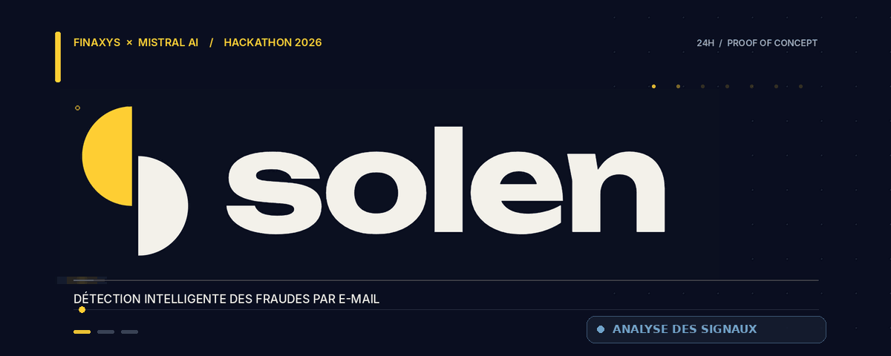
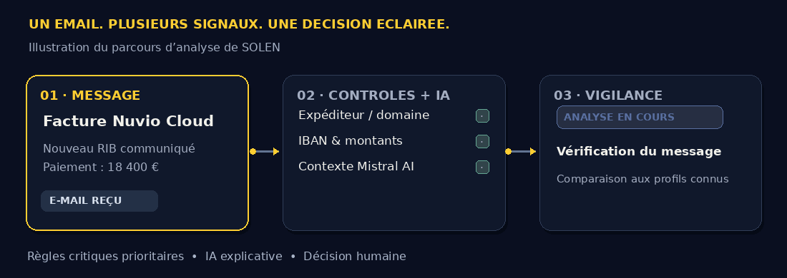
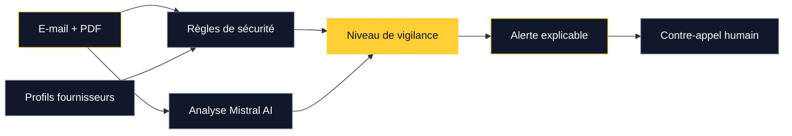

<div align="center">

<a href="https://solen-pi.vercel.app/">
  
</a>

<br />

### La vigilance intelligente, directement dans la messagerie.

**SOLEN** est un prototype d'assistant de détection des fraudes par e-mail : il croise des **règles de cybersécurité** et une **analyse contextuelle par Mistral AI** pour aider les équipes à repérer, comprendre et vérifier les demandes suspectes.

<br />

[](https://solen-pi.vercel.app/)
[](./garde-fou)


**Build What's Next · Hackathon FINAXYS × Mistral AI · 23–24 octobre 2026 · Paris**

[Démo en ligne](https://solen-pi.vercel.app/) · [Profils fournisseurs](https://solen-pi.vercel.app/fournisseurs) · [Équipe](#léquipe) · [Dépôt original](https://github.com/sephorah/hack-the-bank)

</div>

---

## Le problème

Un dirigeant demande un virement urgent. Un fournisseur transmet un **nouvel IBAN**. Un e-mail ressemble à une communication interne, mais son domaine a été subtilement modifié. Même avec une adresse apparemment authentique, une demande peut être frauduleuse.

**Notre idée : intégrer la vigilance là où l'on prend la décision — dans la boîte mail.**

## Une détection qui explique et guide

<div align="center">



<sub>Animation illustrative du parcours d'analyse ; ce n'est pas une capture de l'application.</sub>

</div>

<br />

<table>
<tr>
<td width="33%" valign="top"><strong>01 · Détecter</strong><br/><br/>Contrôler les expéditeurs, les domaines, les IBAN, les montants et les pièces jointes PDF exploitables.</td>
<td width="33%" valign="top"><strong>02 · Comprendre</strong><br/><br/>Compléter les règles techniques par l'analyse des demandes financières et des signaux de manipulation avec Mistral AI.</td>
<td width="33%" valign="top"><strong>03 · Vérifier</strong><br/><br/>Afficher une alerte expliquée et préparer un contre-appel auprès d'un contact déjà connu de l'entreprise.</td>
</tr>
</table>

## Tester la démo

<div align="center">

### [↗ Lancer la démonstration interactive](https://solen-pi.vercel.app/)

*Une boîte de réception fictive inspirée d'Outlook, un panneau de vigilance SOLEN et un parcours guidé.*

</div>

| Scénario | Signal recherché |
|:--|:--|
| **Nuvio Cloud** | Nouvel IBAN différent du profil fournisseur malgré un e-mail crédible. |
| **Facture urgente** | Demande financière à examiner dans le contexte de l'expéditeur et des habitudes connues. |
| **Faux dirigeant** | Tentative d'usurpation accompagnée d'une pression pour effectuer un virement. |
| **Fournisseur allemand** | Changement de coordonnées bancaires signalé dans une facture PDF lisible. |
| **Faux support informatique** | Domaine sosie et lien d'hameçonnage. |

**[Voir les profils fournisseurs de la démo ↗](https://solen-pi.vercel.app/fournisseurs)** — références d'IBAN masquées, domaines, numéros de confiance et fourchettes de paiement, avec des **données entièrement fictives**.

## Sous le capot

<details>
<summary><strong>🔎 Contrôles de sécurité et analyse IA</strong></summary>

<br />

**Règles déterministes :**

- Résultats d'authentification **SPF, DKIM et DMARC** transmis dans les e-mails de démonstration.
- Détection de domaines sosies, d'expéditeurs suspects et d'adresses de réponse incohérentes.
- Comparaison des **IBAN** et **montants** avec les profils fournisseurs simulés.
- Analyse des textes d'e-mails et du contenu extractible des PDF.

**Analyse contextuelle :**

- **Mistral AI** aide à interpréter les demandes de paiement, les formulations pressantes et les techniques d'ingénierie sociale.
- Le prototype masque les IBAN et certains numéros de compte avant de construire l'entrée envoyée au modèle.
- **L'IA ne peut pas annuler une alerte critique** établie par les contrôles déterministes.
- Si Mistral n'est pas disponible, une logique de secours est prévue pour les scénarios de démonstration.

</details>

<details>
<summary><strong>🧠 Architecture technique</strong></summary>

<br />



</details>

## Stack technique

<div align="center">


</div>

| Composant | Technologies |
|:--|:--|
| Application | Next.js, React, TypeScript |
| UI | Fluent UI |
| IA | Mistral AI |
| Analyse des PDF | `unpdf` |
| Tests | Vitest |
| Hébergement de la démo | Vercel |

## Installer le prototype

Le code se trouve dans [`garde-fou/`](./garde-fou).

```bash
cd garde-fou
npm install
npm run dev
```

Ouvrir [`http://localhost:3000`](http://localhost:3000) sur l'ordinateur qui exécute l'application.

Pour activer les appels à Mistral, créer un fichier `garde-fou/.env.local` contenant :

```dotenv
MISTRAL_API_KEY=VOTRE_CLE
```

**Ne jamais committer une clé API.** Pour exécuter la démonstration avec les analyses de secours prévues pour les scénarios simulés :

```bash
SOLEN_AI=secours npm run dev
```

Pour lancer les tests :

```bash
npm test
```

## Maintenant / ensuite

| Prototype de hackathon | Vision et pistes d'évolution |
|:--|:--|
| Interface de démonstration inspirée d'Outlook | Extension réelle pour Outlook et Gmail |
| Profils fournisseurs fictifs | Synchronisation autorisée avec les outils comptables |
| Règles + IA pour des e-mails simulés | Analyse enrichie par le contexte professionnel autorisé |
| Alertes et suggestions de vérification | Validation humaine, signalement et suivi des incidents |
| Tests techniques de scénarios | Évaluations de sécurité, des faux positifs et de la confidentialité |

## L'équipe

**4 personnes · 24 heures · Un prototype commun**

Nous avons conçu, développé, testé et présenté **SOLEN collectivement** lors du hackathon **Build What's Next — FINAXYS × Mistral AI**. Chaque membre a participé aux différentes étapes du projet. Le nom **SOLEN** a été proposé par Akilis Le Quellec.

<table>
<tr>
<td align="center"><a href="https://github.com/akls-lq"><br/><sub><b>Akilis Le Quellec</b></sub><br/><sub>@akls-lq</sub></a></td>
<td align="center"><a href="https://github.com/daciba75"><br/><sub><b>@daciba75</b></sub></a></td>
<td align="center"><a href="https://github.com/barrage75"><br/><sub><b>@barrage75</b></sub></a></td>
<td align="center"><a href="https://github.com/sephorah"><br/><sub><b>@sephorah</b></sub></a></td>
</tr>
</table>

**[↗ Dépôt original de l'équipe](https://github.com/sephorah/hack-the-bank)** · Ce dépôt est un Fork personnel qui présente notre travail commun.

---

> [!NOTE]
> **Proof of Concept.** SOLEN est une démonstration de hackathon utilisant des données fictives. La boîte mail n'est pas reliée à Outlook ou Gmail en production et SOLEN ne bloque pas de vraies transactions. Des évaluations supplémentaires de sécurité, de protection des données et de conformité seraient nécessaires avant tout déploiement professionnel.

<div align="center">

**SOLEN · Détecter. Comprendre. Vérifier.**

[**↗ Voir la démo**](https://solen-pi.vercel.app/) · [**↗ Code d'origine**](https://github.com/sephorah/hack-the-bank)

<sub>Conçu en équipe · Hackathon FINAXYS × Mistral AI · Octobre 2026</sub>

</div>
